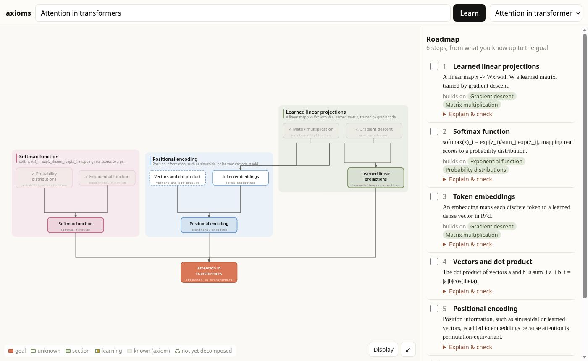
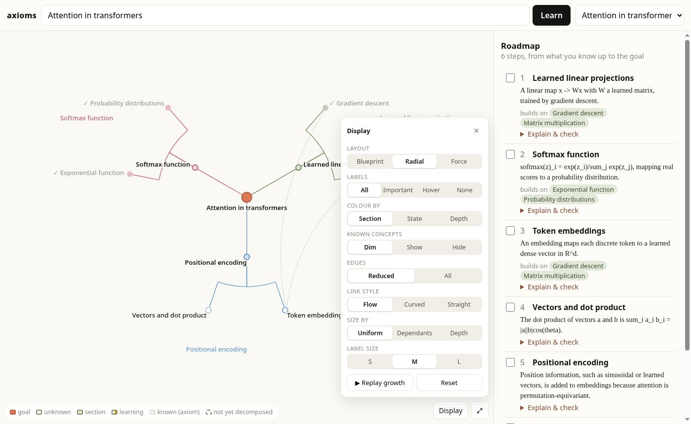
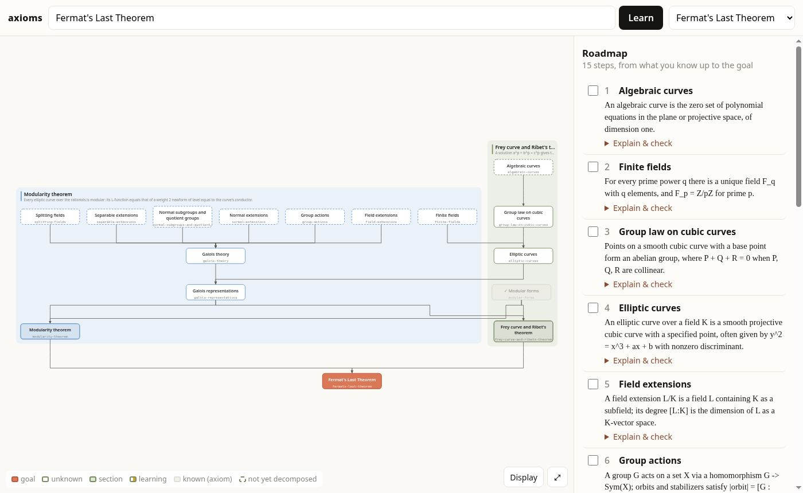
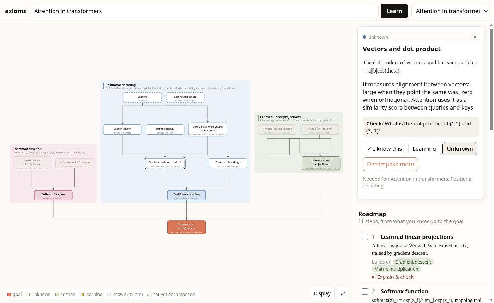
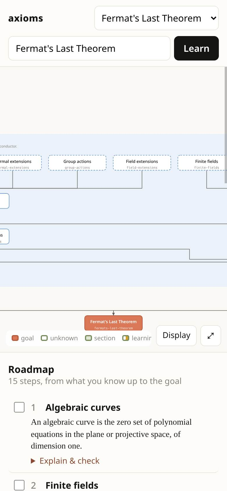
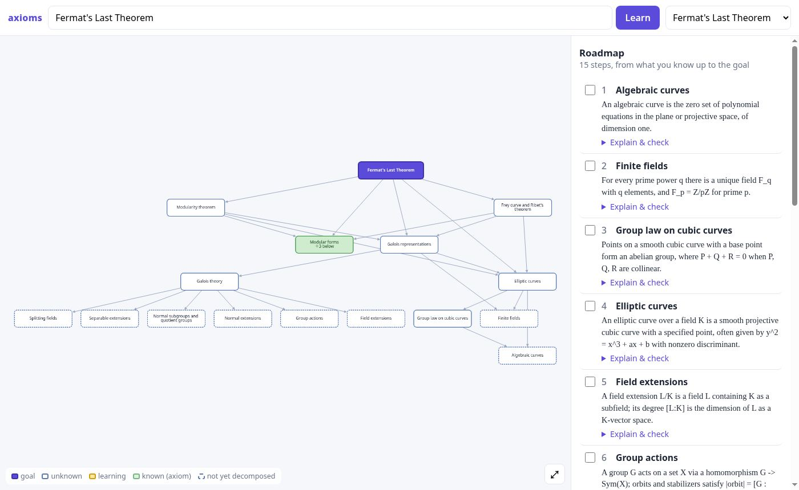

# axioms

Learn any topic starting from what you already know.

State a topic. axioms works backwards from it to what you already know, the
way the [Lean blueprint for Fermat's Last Theorem](https://www.anthropic.com/research/formalizing-fermats-last-theorem)
runs from the theorem down to Mathlib and the axioms. An agent decomposes the
topic into prerequisite concepts. Each has a one-line canonical statement, a
short explanation and a check question, and each edge means *needs*. Mark what
you know: those concepts become your **axioms**, and everything below them
collapses. If you don't get a concept, **decompose** it, and it expands another
level, as deep as you like. The **roadmap** is the path from your known
frontier up to the goal.

The graph is drawn in the visual language of Anthropic's FLT formalisation:
the **blueprint** figure (tinted section panels, sans titles over monospace
ids, orthogonal edges into a clay goal) and the **radial** growth video.

| Reference (study only) | axioms |
|---|---|
|  |  |
|  |  |

| FLT blueprint | After decomposing a leaf | Phone | Before (v0) |
|---|---|---|---|
|  |  |  |  |

## Use it

Open **https://shared-server.taild98079.ts.net:10001** (tailnet only).

- **State a topic** in the top bar ("Fermat's Last Theorem", "attention in
  transformers") and press **Learn**. The first decomposition goes two levels
  deep and takes about 20–60 s.
- **Click a node** to open its card: statement, explanation and check
  question. Then choose **I know this**, **Learning**, **Unknown**, or
  **Don't get it: decompose**.
- **Reading the graph**:
  - Premises sit above the conclusions they serve, and the clay goal is at
    the bottom.
  - Each **section** is one of the goal's direct prerequisites with
    everything below it, drawn as a tinted panel. Its key concept is filled
    with the section's tint.
  - **Unknown** concepts are white, and **learning** carries a gold mark.
  - **Known** concepts (your axioms) are dimmed with a ✓, and nothing below
    them is drawn.
  - A **dashed outline** means the concept has not been decomposed yet.
- **Display** (bottom right) changes how the graph is drawn. Settings are
  remembered per device:
  - **Layout**: blueprint, radial (the FLT video) or force.
  - **Labels**: all, important, hover or none.
  - **Colour by**: section, state or depth.
  - **Known concepts**: dim, show or hide.
  - **Edges**: reduced (the transitive reduction, as the FLT landmark graph
    draws it) or all.
  - **Link style**: flow, curved or straight.
  - **Size by**: uniform, dependants or depth.
  - **Label size**: S, M or L.
  - **Replay growth** redraws the graph from the goal outward.
- **Roadmap** (right panel, or below the graph on a phone): the steps in
  order. Tick a step to mark it known. Click a step to find it in the graph.
- **Your topics** (top right) lists every topic you have stated. Axioms carry
  over, so the next topic starts from what you already marked known, and a
  concept that reappears is reused rather than duplicated.

CLI, sharing the same library:

```sh
nix develop
cargo run -p axioms-cli -- learn "Fermat's Last Theorem"   # tree + roadmap
cargo run -p axioms-cli -- mark known "Modular forms" "Elliptic curves"
cargo run -p axioms-cli -- decompose "Galois theory" "Fermat's Last Theorem"
cargo run -p axioms-cli -- show "Fermat's Last Theorem"
```

## Run

```sh
nix develop                 # toolchain (rustc, cargo, clippy, rustfmt); sets the git hook
scripts/serve.sh            # build, start detached on 127.0.0.1:4401, tailscale serve :10001
scripts/check.sh            # fmt --check, clippy -D warnings, tests (also the pre-commit hook)
```

`scripts/serve.sh` starts the server with `setsid nohup` and a **clean
environment**, so `claude -p` runs with the host's own signed-in Claude Code.
The log is at `~/.local/state/axioms/server.log`.

**Not persistent across reboots.** This host has unexplained hardware resets.
After a reboot, run `scripts/serve.sh` again. The tailscale serve config
survives, but the process does not.

Data: `~/.local/share/axioms/nodes.jsonl` (override with `AXIOMS_DATA`).

To keep the library in a [kb](https://github.com/popemkt/kb) store instead,
run with `AXIOMS_STORE=kb AXIOMS_KB_ROOT=<dir holding .kb/>`. Concepts become
`#concept` nodes with typed fields, and `needs` becomes a ref field. See
[DESIGN.md → kb integration](docs/DESIGN.md#kb-integration).

### Model provider

| `AXIOMS_PROVIDER` | What | Settings |
|---|---|---|
| `claude-cli` (default) | `claude -p --output-format json --json-schema …` as a subprocess, with tools, settings and MCP off | `AXIOMS_MODEL` (default `sonnet`), `AXIOMS_CLAUDE_BIN` |
| `openai` | any OpenAI-compatible endpoint through **Rig** (e.g. CLIProxyAPI) | `AXIOMS_OPENAI_BASE_URL`, `AXIOMS_MODEL`, key in the env var named by `AXIOMS_OPENAI_KEY_ENV` (default `OPENAI_API_KEY`) |

No key is ever stored in the repo or the library. The owner's CLIProxyAPI on
popemkt-work was not reachable over the tailnet when v0 was built (nothing
answered on :8317), so the default is the `claude -p` subprocess. To point
axioms at it later:
`AXIOMS_PROVIDER=openai AXIOMS_OPENAI_BASE_URL=http://popemkt-work:8317/v1 AXIOMS_MODEL=… scripts/serve.sh`.

## Live mode (SpacetimeDB)

With `AXIOMS_STORE=spacetime` the library lives in SpacetimeDB and every
open view is live. Mark a concept known on your phone and the laptop
redraws at once. Ask for a decomposition anywhere and it grows node by node
in every view. Each browser is its own person (an identity kept in
localStorage). The graph is shared; what you know is yours. Click the
**live** badge to copy a link that makes another device you.

```sh
scripts/spacetime-install.sh   # SpacetimeDB 2.14.0 in ~/.local/share/axioms/spacetime
scripts/serve-live.sh          # SpacetimeDB + live server as systemd units, on :10001
scripts/spacetime publish -s axioms axioms --module-path spacetime -y   # after module changes
AXIOMS_STORE=spacetime axioms import ~/.local/share/axioms/nodes.jsonl  # bring a JSONL library in
```

`scripts/serve-live.sh` is also the restart after a reboot. See
[DESIGN.md → SpacetimeDB](docs/DESIGN.md#spacetimedb).

## Architecture

A Cargo workspace of small crates. Each file has one purpose and stays under
about 200 lines.

| crate | role |
|---|---|
| `core` | concepts, the "needs" DAG (`petgraph`), the view projection, the roadmap, and the merge of a decomposition. Pure: no IO, no async. |
| `store` | the `Store` trait. `JsonlStore` and `MemoryStore` both go through one codec into kb-style nodes (everything is a node, edges are ref props). |
| `agent` | the `ModelProvider` trait (`ClaudeCli`, `RigOpenAi`), the `ConceptSource` trait (`LlmSource`, `ScriptedSource`), the prompt contracts, and the `Learner` loop. |
| `server` | `axum`: the JSON API under `/api`, and the static UI from `web/`. |
| `live` | SpacetimeDB clients: the server's self-healing `Mirror`, the decompose `worker` (also `axioms-worker`), and `SpacetimeStore`. Its `bindings/` are generated. |
| `cli` | `clap`: `axioms learn/show/decompose/mark/topics/import`. |
| `spacetime/` | the SpacetimeDB module (wasm32, outside the workspace): tables and reducers. `spacetime/web/` bundles the TS SDK for the UI. |
| `web/` | vanilla ES modules with no build step. An SVG renderer of its own, with layouts in `web/js/layout/` and drawing in `web/js/render/`. dagre 3.1.3 (MIT) is vendored in `web/vendor/`. |

The design is in [docs/DESIGN.md](docs/DESIGN.md): the graph model, the
decomposition prompt contract, the roadmap algorithm, dedupe, the kb store,
and live mode on SpacetimeDB.

### Deviations from the brief

- **Rig is used for the HTTP provider path, not for the `claude -p` path.**
  Rig 0.45 has no subprocess transport. Wrapping `claude -p` as a Rig model
  would mean implementing its wire and transport traits for one call, which is
  ceremony that buys nothing. Both providers implement one small trait
  (`ModelProvider`: a system prompt, a user prompt and a JSON schema in, JSON
  out), so the agent logic is identical either way.
- **"Explanation" is part of the decomposition answer**, not a separate call.
  One call returns names, statements, explanations and check questions, which
  keeps the first view at a single model round trip.

## Credits

The graph's look is modelled on Anthropic's
[Formalizing Fermat's Last Theorem](https://www.anthropic.com/research/formalizing-fermats-last-theorem):
its blueprint figure and formalisation video, and the
[FLT in Lean 4 landmark graph](https://tianyipeng.github.io/fermats-last-theorem/).
The captures in `docs/media/reference/` are kept **for study only**. They are
not shipped with the app, and their copyright stays with their owners. The
display options mirror the graph lens of [kb](https://github.com/popemkt/kb)
without sharing its code.

Live mode bundles the [SpacetimeDB](https://github.com/clockworklabs/SpacetimeDB)
TypeScript SDK 2.14.0 into `web/vendor/spacetimedb.js`. Its npm metadata says
ISC; the repository's licence, vendored as `web/vendor/LICENSE.spacetimedb`,
is the Business Source License 1.1.
