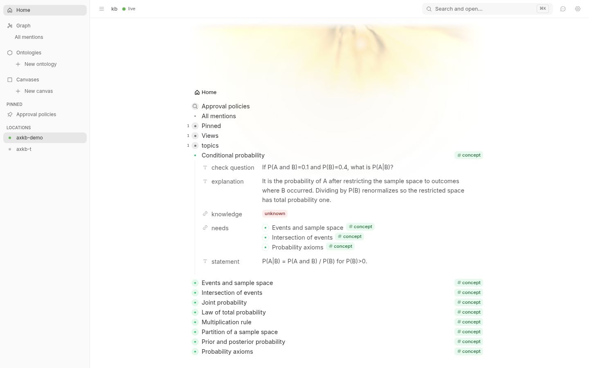
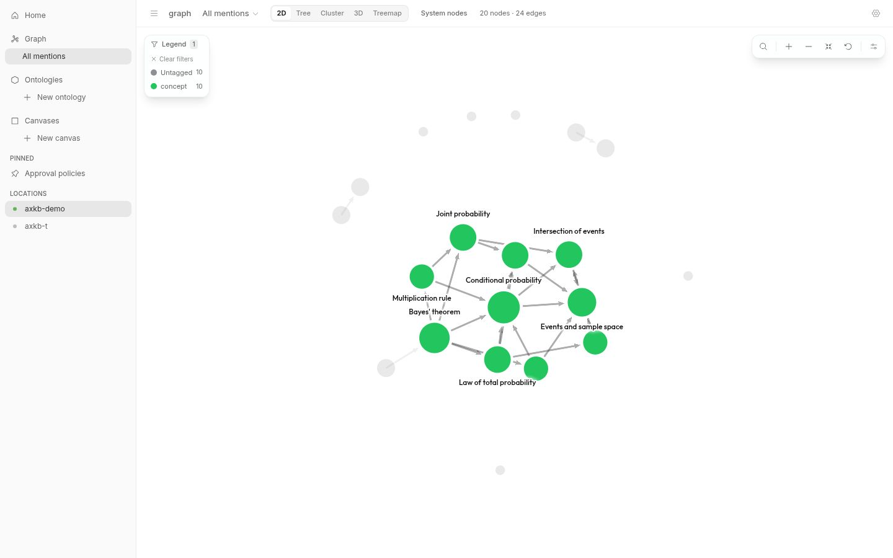
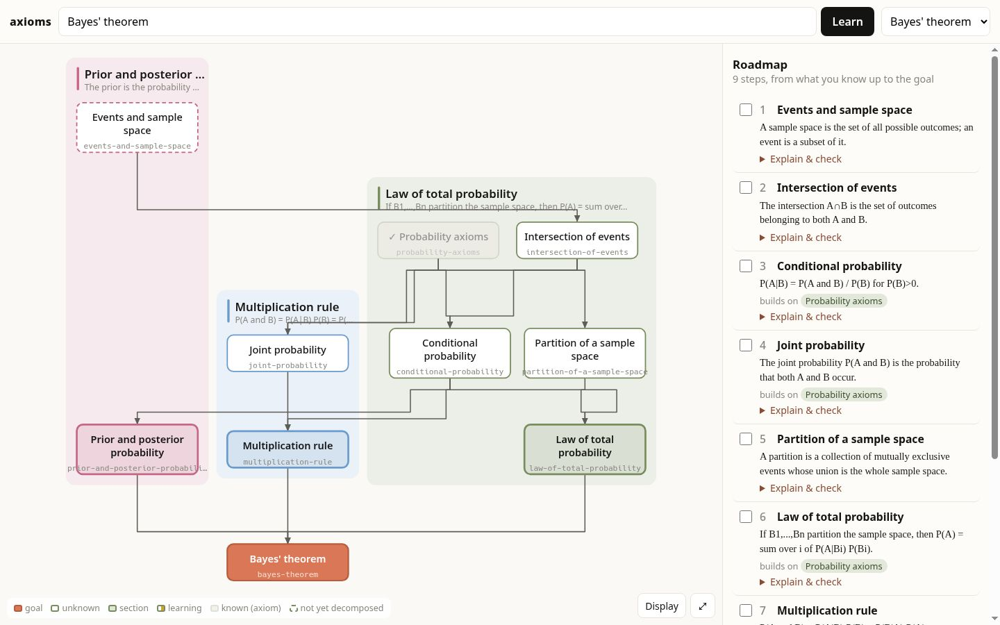

# axioms: design

## Graph model

- A **concept** has an `id` (its normalised name, suffixed `-2`, `-3` … when
  distinct concepts share a name), a `name`, a one-line canonical
  `statement`, an `explanation`, a `check` question, and `knowledge`
  (`unknown | learning | known`). `known` makes it one of the learner's
  **axioms**. Knowledge belongs to the concept, not to a topic, which is why
  axioms carry over between topics.
- An **edge** `A → B` means *A needs B*. The graph is one global DAG
  (`core::ConceptGraph`, on petgraph). `add_need` refuses self-loops and any
  edge that would close a cycle. Merges count those edges as `dropped_edges`
  rather than failing.
- A **topic** is just a concept that the learner stated. `Library.topics` keeps
  their order, most recent first.
- The **view** of a goal (`core::view`) is derived: a walk down from the goal
  that does not descend below a known concept. Each drawn node carries a
  `status` (`goal | unknown | learning | known`), `hidden_below` (how many
  concepts its being known hides), and `decomposed` (whether it has any
  prerequisites). The UI draws exactly this, and nothing in the view is stored.

## Display structure

`core::view` also gives each drawn concept the facts that drawing needs,
so the UI never re-derives graph facts (`core::structure`):

- `depth`: the fewest "needs" steps from the goal.
- `dependants`: how many drawn concepts need it.
- `section`: the section it belongs to.
  - Section roots are the goal's direct prerequisites in the **transitive
    reduction**.
  - A concept joins its nearest root. A tie goes first to the section most of
    its dependants are in, so a branch keeps one colour; then to the smaller
    section, so panels stay balanced; then by id.
  - Every concept but the goal has a section.
- `implied` (on the view): edges that a longer path already implies.
  Dropping them gives the transitive reduction, which is what the FLT
  landmark graph draws and what "Edges: reduced" shows.

## Rendering

**Choice: a small SVG renderer of our own, with dagre for the layered
layout.**

The target look is Anthropic's FLT blueprint figure and video, studied from
the captures in `docs/media/reference/`. Its features:

- an ivory page;
- tinted section panels, each with a coloured bar, a title and a subtitle;
- rounded boxes with a sans-serif title over a monospace identifier;
- dark orthogonal edges that merge into buses;
- a clay goal at the bottom;
- in the video, a radial dendrogram that grows outward from the goal, with
  one hue per section.

Why not the alternatives:

- **Cytoscape** (v0's renderer) cannot draw two type styles in one label,
  polar elbow edges, or panel headers.
- **Graphviz in WASM** (which the landmark graph uses) gets the static look
  but not smooth growth or interaction, and it costs a large WASM download.
- **sigma.js / WebGL** is built for thousands of nodes, and our graphs have
  tens.

The pipeline, `web/js/`:

1. `model.js`: view + settings → a drawing model. It filters known
   concepts, reduces edges, measures and wraps labels, and assigns hues.
2. `layout/`: each layout takes the model and returns positions, plus panels
   or labels.
   - `blueprint`: dagre top-down. Each section is a dagre cluster, drawn as
     a panel.
   - `radial`: a spanning tree that prefers a parent in the same section,
     with leaf-proportional wedges and a gap between sections.
   - `force`: relaxes from the radial positions; deterministic.
3. `render/`: SVG nodes, sections and edge paths, plus pan, zoom and pinch.
   - "flow" edges are orthogonal buses in the blueprint and polar elbows in
     the radial layout.
4. `render/scene.js` animates between drawings:
   - concepts glide to their new places;
   - new concepts grow out of the concept that needs them, nearest the goal
     first;
   - edges draw themselves in afterwards;
   - **Replay growth** redraws from nothing.

**State over hue.**
- The section hue colours the outline.
- The goal is clay, and a section's key concept is filled with its tint.
- Learning carries a gold mark.
- Known is dimmed (or shown, or hidden) and marked ✓.
- Not decomposed is a dashed outline.

**Settings** (`settings.js`) are one schema that the Display panel renders.
They are stored in `localStorage`, so they are per device, and they mirror
kb's graph lens: layout, label density, link style, colour by and size by.

## Decomposition prompt contract

One call per decomposition (`agent::prompts`). The input is the target's name
and statement, the goal it serves, the concepts that need it, the names of
known concepts (axioms), the names of other existing concepts, and a depth.

- **Depth 2** is used when a topic is stated: 3–6 direct prerequisites, each
  with 2–4 of its own.
- **Depth 1** is used when "decompose" is clicked: direct prerequisites only.

The output is JSON constrained by a JSON schema (`--json-schema` for
`claude -p`, or `output_schema` plus prompt instructions through Rig). Its
shape is exactly `core::Decomposition`:

```json
{
  "target":   {"name", "statement", "explanation", "check", "needs": ["<name>", …]},
  "concepts": [{"name", "statement", "explanation", "check", "needs": ["<name>", …]}]
}
```

`needs` entries are names. They resolve first against the proposals in the
same answer, then against an existing concept with that exact normalised name.
That second path is how a decomposition links to your axioms without
re-describing them: the prompt lists the known names and asks the model to
spell them exactly. Unresolvable names are ignored. A proposal that is the
target itself is dropped.

## Roadmap

`core::roadmap(view)` is derived from the view and never stored. It is a
depth-first **post-order** from the goal over the concepts that are not yet
known:

- Each concept is placed right after its own unknown prerequisites, which
  makes it a valid topological order.
- A branch is finished before the next begins, so it reads as a path, not as
  layers.
- Siblings go simplest first: by height (the longest unknown chain below
  them), then by name.

Each step carries `builds_on` (its known prerequisites: the axioms it starts
from) and `after` (its unknown prerequisites, all earlier steps).

## Dedupe (v0)

Two layers:

1. **Name normalisation** (`core::normalize`): lowercase, drop apostrophes and
   punctuation, drop a leading article, and join words with `-`. Equal normal
   forms mean a **collision**.
2. **"Same concept?" judge.** All collisions from one decomposition go to the
   model in **one** batched call. It gets each proposal's statement against the
   candidates' statements, and answers with a candidate id or `null`. Only
   offered ids are accepted.
   - `Same(id)`: link to the existing concept. Its text is kept, because a
     statement has one home.
   - `Distinct`: create a new concept with a suffixed id ("ring" in algebra
     vs. a ring buffer).

The prompt also lists the existing concept names and asks for exact reuse,
which avoids most collisions in the first place. Not done yet: synonyms with
different names ("Softmax" vs. "Softmax function") are not merged, and there is
no manual merge and no alias list. That is the "proper merging" left for later.

## Concurrency

The `Learner` never holds the library lock across a model call. It snapshots
the request, calls the model, re-locks to find collisions, calls the judge,
and re-locks to apply. The server bounds concurrent model calls to 2, and
every mutating API call saves and answers with the fresh blueprint.

## Persistence: kb-shaped nodes

`store` writes the library as kb's node shape
(<https://github.com/popemkt/kb/blob/main/DESIGN.md>, *Data model*), one node
per line:
`{id, text, props: {<field-node-id>: [{t, v}]}, children, createdAt, updatedAt}`.

- Concepts are nodes tagged `ax.tag.concept` (`sys.f.type`). Their id is the
  concept id, and `text` is the name.
- Props: `ax.f.statement`, `ax.f.explanation` and `ax.f.check` (str);
  `ax.f.needs` (ref, one per edge); `ax.f.knowledge` (ref to an option node).
- `ax.f.knowledge` declares its options as its own children
  (`ax.k.unknown | learning | known`), which is kb's option-set shape.
- The schema (fields, the tag, the options) is written as nodes too. The
  topics are the ordered children of `ax.topics`.
- `sys.*` ids are kb's seeded nodes: referenced, never written.
- A save keeps each node's `createdAt`, and moves `updatedAt` only when its
  content changed.

## kb integration

`AXIOMS_STORE=kb AXIOMS_KB_ROOT=<dir holding .kb/>` keeps the library in a
kb store instead of the JSONL file. `KbStore` (`crates/store/src/kb/`) is a
second implementation of `Store` behind the same codec, so both stores write
the same nodes. There is no shared code with kb and no rewrite of it.

**Interface.** `KbStore` talks to `kb mcp`, kb's MCP server on stdio. kb's
DESIGN names one action registry served by the CLI, MCP and HTTP alike, so
these are the same actions as `kb action-invoke`. A session is one process
per load or save: dozens of calls cost one start-up (about 0.5 s) instead of
one each, and nothing stays running. axioms never reads `.kb/` files, so a
sqlite-backed kb works the same. `AXIOMS_KB_BIN` names the binary (default
`kb`).

**Mapping.**

| axioms | kb |
| --- | --- |
| concept | a node with id = the concept slug, text = its name, tagged `#concept` (`ax.tag.concept`, `sys.f.type`) |
| statement, explanation, check | text fields `ax.f.statement`, `ax.f.explanation`, `ax.f.check` (`sys.ft.text`, cardinality one) |
| needs edge | ref prop on the field `ax.f.needs` (`sys.ft.ref`, `sys.f.targetTag` → `#concept`) |
| knowledge state | ref prop on `ax.f.knowledge` (cardinality one) to one of its option children `unknown`/`learning`/`known` |
| topics | the ordered children of an `ax.topics` node |

The `#concept` tag templates all five fields, so kb shows and offers them on
every concept. Props are keyed by field node, as kb keys them. The
roadmap and view are still derived and never stored.

**Writes.** A save diffs the codec's nodes against what kb holds and
writes only the difference. It runs in four passes, so every ref has its
target before it is written:

1. **Mint.** Missing fields are minted with `field.define` and the tag with
   `tag.define`, with explicit `ax.*` ids. Missing concepts are minted with
   `node.add`.
2. **Place.** Children are put in order with `node.update` (parent and
   position).
3. **Props.** Props are set and unset with `node.update`.
4. **Delete.** Concepts that axioms no longer has are removed with
   `node.delete`, reparenting their children.

kb validates every write: a value must fit its field's type, and a ref must
name a stored node.

**Shared ownership.** axioms owns only its `ax.*` fields on a concept. It
only ever adds to `sys.f.type` and `sys.f.fields`, and it ignores children it
did not place. A person can tag a concept, give it their own fields, or
nest notes under it, and saves keep all of that.

**Seeing it in kb.** Concepts show in the outline with their fields. To see
the blueprint in kb's graph view, tick Graph options → Relationships →
`needs`. `kb query` reads the DAG directly:

```sh
kb --root "$AXIOMS_KB_ROOT" query \
  '[:find ?from ?to :where [?a :f/ax.f.needs ?b] [?a :node/text ?from] [?b :node/text ?to]]'
```

**Known limits.**

- **Last writer wins on axioms' fields.** The server loads the library once
  at start. If a concept's `ax.*` fields are edited in kb while the server
  runs, the next save puts axioms' copy back. Edits made in kb are picked
  up on the next start.
- **`targetTag` is not enforced.** kb refuses a dangling `needs` ref, but
  not one that points at a non-concept node. kb uses `targetTag` to scope
  its pickers, not to check writes. On load, axioms skips a `needs` edge
  whose target is not a concept rather than failing.
- **Ids are slugs, not ULIDs.** That is legal in kb. A field the person
  already has with the same name (say "statement") is not reused: axioms
  mints its own with an `ax.*` id, so the two never mix.
- **Every save is a full diff.** Each save reads all concepts first. That
  is fine at hundreds of concepts; at many thousands it would want
  `graph.changes`.
- **kb records opened roots.** `kb init` and `kb ui` add the root to the
  person's location list in their home store. `kb mcp`, which axioms uses,
  does not. Tests and demos set `KB_HOME` to a throwaway home.
  `KbStore::with_home` does the same, so they never touch the person's own
  kb.

Tests: `crates/store/src/kb/plan.rs` tests the diff without kb. Run
`cargo test -p axioms-store -- --ignored` for the round trip through a real
kb in a temp store and temp home.

| kb outline: a concept with its fields | kb graph: the `needs` relation | axioms, reloaded from kb |
| --- | --- | --- |
|  |  |  |
